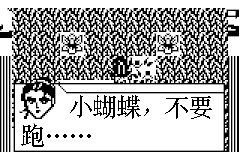
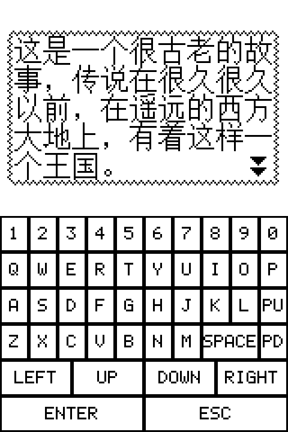

# GAMForge

**经典游戏，原生新生。**

GAMForge · GAM 原生重编译器

将 BBK A 系列 GAM 游戏离线重编译为 BBK 9288 / 9288T / 9288S / 听说王600 原生程序。

Recompile BBK A-series GAM games into native BBK 9288 / 9288T / 9288S / TSW600 applications.

[](https://github.com/HelloClyde/gamforge/actions/workflows/build.yml)
[](LICENSE)

把 A 系列 C6502 `.gam` 游戏在 **PC 上离线翻译为 S1C33 原生程序**，
封装为独立 EXE：9288/T 使用 KF2，9288S / 听说王600 使用 D300。
安装分类为“娱乐”，听说王600 为“游戏”。提供 Windows / macOS 图形界面和命令行工具。

> 当前是实验性编译器，不是“任意 GAM 均兼容”的成品。编译成功不代表全流程或
> 真机性能已经验证。输出不是 Windows EXE，也不是携带游戏的播放器。

## 功能

- 选择 GAM，查看标题、体积与入口；设置程序名称和图标。
- 输出机型可选 9288（320×240，2×）或 9288T（240×160，默认 1.5× 四灰阶锐利缩放＋清晰文字），分别使用对应 SDK；T 仍可选 1×、最近邻和双线性。
- 新增实验性 9288S（160×240）输出：上半屏点对点游戏，下半屏触摸软键盘，使用独立 9288S SDK。
- 新增实验性听说王600 输出：复用 S 的运行载荷和软键盘，使用独立 `0xD500` 包头标记及“游戏”分类。
- 9288 / 9288T 可在「按键映射…」中自定义功能键、字母和数字键，按机型保存并支持恢复默认；9288S / 听说王600 保持固定软键盘。[映射说明与命令行用法](docs/key-mapping.md)。
- 40×40 / 16×16 四灰阶图标预览；9288 保留系统边框，9288T 不添加白框背景。
- 9288S 使用原生 32×32 双帧四灰阶图标，D300 封装与官方 Apmk 逐字节对照验证。
- 一键原生转换，显示真实阶段、耗时与日志，支持取消。
- 可选[按需崩溃追踪](docs/crash-tracing.md)：游戏中临时开启，关键调用前后保存轮换快照，便于分析真机重启问题。
- 名称写入 KF2 和应用标题；默认输出文件名跟随名称。
- 编译成功、链接完整及体积检查通过后才替换旧 EXE。
- 默认单 EXE 内置未压缩资源，直接使用系统已载入的字节，不分配整份 GAM 副本；可选“EXE＋外置资源文件”。
- [按游戏隔离存档](docs/game-saves.md)：`A:\系统\数据\游戏\<源 GAM 文件名>\`，与 EXE 名称和显示模式无关。
- 两种模式均包含原生游戏代码和共享运行库，真机不需要原 GAM、BIN 或 GNA 文件。
- 正式分发默认提供 Windows / macOS 全套 Full 包：Python/Tk/Pillow、PC 启动状态生成工具、各机型 SDK、A 系列固件及本机原生 S1C33 工具链齐全，无需额外安装转换依赖。

## 快速开始（Windows）

1. 从 [Releases](https://github.com/HelloClyde/gamforge/releases) 下载
   **`gamforge-<版本>-full-windows-x64.zip`**，完整解压后运行 `GAMForge.exe`。
2. Full 包已配好所需 SDK、工具链、固件和 Windows 工具链运行库，
   无需安装 Python、编译器或手动填写依赖路径。
3. 选择自己有权使用的 GAM，设置名称、图标和输出位置，点击转换。
4. 将生成的 EXE 复制到真机 `A:\系统\程序\`，在“娱乐”分类启动（听说王600 为“游戏”）。

**发布策略已改为三平台默认 Full**：后续 tag 只有在 Windows、Apple Silicon Mac、Intel Mac
全套包均通过隔离转换检查后才发布，不以轻量包代替失败的 Full 包。
这不追溯改变历史附件：v1.5.0 首次发布的是轻量包，v1.4.0 有 Windows Full；
实际可下载文件仍以 Releases 附件为准，名称不含 `full` 的历史包需要自行配置依赖。

全套版包含经维护者确认获授权分发的所需 SDK 头文件和固件；源码仓库和 PR 轻量测试包不含它们。
请保留包内 `dependencies`、`_internal` 目录，不要只复制单个 EXE。支持 Windows 10/11 x64。
9288 / 9288T 分别使用对应 SDK；9288S / 听说王600 的当前后端共用 **9288S SDK**。
这不代表所有机型的 SDK 可以互换，尤其不能使用 9588 SDK 或 9288T 头文件编译 S / 600。
v1.3.0 起全套包包含四个输出目标所需依赖；v1.2.0 支持 9288 / 9288T，v1.1.2 仅支持 9288。
工具链不是普通 LLVM；构建方法见 [工具链说明](toolchain/README.md)。

名称最多 15 个 GBK 字节（通常 7 个汉字），不支持 emoji。9288 桌面标签采用 EXE
文件名；另行修改输出文件名也会改变桌面标签。每次生成同名 `.elf`、`.map` 和
`.report.json`。单文件模式真机只需 EXE；外置模式还需配套 RES。
工作目录默认 `%LOCALAPPDATA%\A9288\work`。

### macOS（v1.5.0 新增）

新增 Apple Silicon（`arm64`）和 Intel（`x86_64`）两套原生构建，均提供
`GAMForge.app` 和 `GAMForge-CLI`，不依赖 Wine。默认下载
`gamforge-<版本>-full-macos-arm64.zip` 或 `gamforge-<版本>-full-macos-x86_64.zip`，
解压即可转换，不需要安装 Python、Xcode、Homebrew 或另配 SDK/工具链。
请按“关于本机”的芯片选择架构，不要把 Windows ZIP 改名为 Mac 版。

两种 Mac 的原生应用构建、冻结 worker、解压后 GUI 和签名检查已通过
[测试分支 CI](https://github.com/HelloClyde/gamforge/actions/runs/38846423429)。
该记录只证明轻量应用通过，不代表历史 Full 已发布；新的发布流程还要求同架构原生工具链
和全套包隔离转换检查通过，具体以每次 Release 的构建记录为准。

Mac 构建与源码运行方法见 [macOS 使用与打包](docs/macos.md)。Full 包包含
Python/Tk/Pillow、本机启动 helper、对应 SDK、A 系列固件，以及
**Mac 原生的定制 S1C33 工具链**；不能使用 Windows `.exe` 或 Apple 自带 Clang 替代。
Mac ZIP 必须在对应架构 Mac 上实际构建、转换验证后才发布。当前使用 ad-hoc 签名，
未经 Apple 公证，首次打开可能需要按系统提示仅允许此应用运行；不需要关闭系统安全保护。
Mac 配置与工作目录位于 `~/Library/Application Support/GAMForge/`，不会写入 `.app`。

### EXE＋外置资源文件（v1.1.0 新增）

两种模式的资源均不压缩，启动快照也不压缩。单 EXE 的资源作为可写数据随程序
载入，读写直接使用同一份内存，不再 `malloc(GAM大小)` 或解压；磁盘 EXE 不会被改写。
这会增大 EXE 文件，超过机型上限时必须选择外置 RES，不会自动退回压缩模式。

在转换界面勾选 **EXE＋外置资源文件**，或在下方命令末尾添加
`--external-resources`。成功后输出 EXE 和内容标识命名的 `Rxxxxxxx.RES`。
将 EXE 复制到真机 **`A:\系统\程序\`**，RES 复制到 **`A:\系统\数据\`**。
不要重命名 RES，也不要混用其他转换的资源。

外置模式仍是 PC 离线编译的原生程序，不会在真机解释 GAM 指令。
未压缩资源采用 4 KiB 分页、128 KiB 固定缓存，不在启动时分配完整 GAM。
游戏对资源地址的写入保存在独立的会话内存（上限 256 KiB），不改写 RES；
资源缺失、文件头不匹配、长度异常、读取失败或内存不足会报错退出。
真机不计算资源页或校验表 CRC，避免每次缺页重复扫描整页；PC 仍生成兼容的
RES v1 文件，已有配套 RES 无需修改。文件头、长度检查不等于内容完整性检查，
同长度的资源内容损坏不会被运行时检测。
正常游戏存档仍由原有存档接口处理。

此选项解决资源导致的 EXE 体积和整份资源内存问题；原生代码本身仍受
机型体积限制：9288T 的完整 EXE 最大 2.5 MiB（2,621,440 字节，含 KF2 头及图标），
此扩展为实验性、尚未经真机验证；其他目标保持完整 EXE 小于 1 MiB。
不能保证任意游戏兼容。缓存未命中需要读盘，实际速度需真机验证。
RES 包含游戏数据，和游戏 EXE 一样不应提交到本项目仓库或翻译器分发包。

## 开发与命令行

需要 Python 3.11+；源码运行还需要 Tkinter、PC C 编译器（Windows/Linux GCC，macOS Clang）。
冻结分发包自带本机预编译 PC helper。以下为 Windows 命令；[Mac 命令](docs/macos.md#从源码运行)单独说明。

```powershell
python -m venv .venv
.venv\Scripts\python -m pip install -r requirements-dev.txt
.venv\Scripts\python -m a9288 gui

.venv\Scripts\python -m a9288 convert "游戏.gam" --app-name "游戏名称" `
  --sdk "你的9288SDK目录" --toolchain "你的S1C33工具链目录" `
  --rom8 "你的固件目录\8.BIN" --rome "你的固件目录\E.BIN" --output "游戏名称.exe"
```

可使用 `A9288_SDK`、`A9288_TOOLCHAIN`、`A9288_ROM8`、`A9288_ROME` 设置默认值。
`A9288_WORKSPACE` 可覆盖工作目录。不会联网上传游戏、图标或转换产物。

### 输出 9288T EXE

界面选择“输出机型 → 9288T”，在“编译环境”选择含 `include/Dsys.h` 的
9288T SDK 根目录。两种机型的 SDK 路径分别记忆，不会复用另一机型的设置。
命令行添加 `--target 9288t --sdk "你的9288T SDK根目录"`；
`A9288T_SDK` 可设置其默认路径。工具链和 A 系列 BIN 与 9288 转换共用。

9288T 默认使用 **1.5× 四灰阶锐利缩放＋清晰文字**（`1.5x-sharp`）：
图片采用像素面积采样，输出 239×144，上下各留 8 像素；文字独立使用 24 点阵，
不经过图片滤波。CLI 省略 `--display-scale` 即使用此模式。
GUI 已保存的合法缩放选择仍会保留；老用户可在“画面缩放”中主动选择锐利模式。

可选 `1x` 点对点居中（159×96，x=40/y=32）、`1.5x` 最近邻和
`1.5x-linear` 四灰阶双线性。最近邻不做灰阶混合，但非整数缩放的笔画粗细不均；
双线性图片较柔，两种滤波模式均保留独立清晰文字。
实现、边界和局部性能对照见 [图片与文字缩放](docs/9288t-text-scaling.md)。
缩放在 PC 转换时选定，已有 EXE 需重新转换；9288 固定 2×，不受此设置影响。
9288T 使用 GUI 按键消息，支持方向、确定、退出、空格、翻页、帮助、Shift、字母和数字，
保留系统电源消息处理。保留内置资源 / 外置 RES 两种模式和娱乐分类。
这是 **GAM → 9288T EXE**，不接收既有 9288T EXE 作为翻译输入。
适配范围与验证记录见 [9288T 输出说明](docs/9288t-target.md)。
**9288T 已验证《魔塔》《伏魔记》的模拟器启动；仍需真机验证，不保证任意 GAM 或完整游戏流程兼容。**

### 输出 9288S EXE（v1.3.0，实验性）

界面选择“输出机型 → 9288S”，使用含 `Down_Include/Dsys.h` 的 **9288S SDK** 根目录。
机型分别记忆 SDK 路径；CLI 添加 `--target 9288s --sdk "你的9288S SDK根目录"`，
或设置 `A9288S_SDK`。v1.3.0 全套包已包含此目标所需依赖。

9288S 物理屏为 160×240、2-bpp、每行 40 字节。上半屏中央（x=0、y=12）以 1×
展示 159×96 游戏画面，按 160×96 区域输出，最右隐藏位留白，不裁切或插值。
下半屏 y=120..239 提供数字、QWERTY 字母、空格、翻页、方向、ENTER、ESC 触摸键。
ENTER 为游戏确定，ESC 为游戏退出/菜单，遵循各游戏本身的逻辑。
实体方向、确定和退出键同样可用；按下进入私有 FIFO，绘图检查点只采集、不消费。
触屏使用 SDK 校准后的窗口坐标和成对 DOWN/UP 消息，不调用固件私有触屏函数。

输出使用 **D300**，不是改名的 KF2；两者不能交叉安装。支持单 EXE 和 EXE＋外置 RES，
安装路径与上述相同。单元/像素回归和实际编译不代表所有游戏、真机触控、存档及性能均已验证。
平台实现说明见 [9288S 适配](docs/9288s.md)。

### 输出听说王600 EXE（v1.3.0，实验性）

界面选择“输出机型 → 听说王600”；CLI 添加 `--target tsw600`。
当前后端与 S 共用含 `Down_Include/Dsys.h` 的 9288S SDK 和 160×240 分屏运行载荷，
但采用听说王600 的 **D300 `0xD500` 兼容标记及“游戏”分类**，不能直接安装 S 的 EXE。
使用 v1.3.0 全套包无需配置路径；源码可用 `--sdk` 或 `ATSW600_SDK`，未设置时回退到 `A9288S_SDK`。
GUI 为两种目标分别记忆 SDK 设置。图标为不添加 9288 白框的 32×32 双帧四灰阶图标。

支持单 EXE 和 EXE＋外置 RES；EXE 放 `A:\系统\程序\`，RES 放 `A:\系统\数据\`。
已检查原机包头、官方 Apmk 封装、共享载荷与像素回归；**尚无 600 真机启动、触控和完整流程验证**。
S 模拟器验证不能替代 600 验证。实现依据及边界见 [听说王600 适配](docs/tsw600.md)。

## 输出示例

9288T 模拟器：默认四灰阶锐利图片与清晰点阵文字同时显示。
截图来自生成后的《伏魔记》；分发包不包含游戏。



下图为本项目生成的《魔塔》原生程序在 **9288S 模拟器**中的实际画面：
上半屏点对点游戏，下半屏触摸软键盘。它不是听说王600 真机验证，
也不表示工具包包含该游戏。



## 项目结构

```text
src/a9288/
  gui.py, cli.py       界面与公共转换入口
  app_options.py      GAM 校验、名称和图标策略
  paths.py            安装路径、工作区、子进程协议
  targets.py          各输出机型、显示和 SDK 配置
  compiler/
    frontend.py       函数、调用关系和控制流恢复
    cfg.py, isa.py    6502 解码与控制流基础设施
    semantics.py     C6502 编译器语义模板
    functions.py     函数分组与跨 bank 目标恢复
    backend.py       S1C33 原生代码生成
    build.py           原生运行库链接
    kf2.py, d300.py    KF2 / D300 分机型封装
    boot.py          PC 离线启动状态准备
    compression.py   旧格式 LZSS 工具（当前构建不使用）
  data/
    runtime/         真机原生运行库、链接脚本、9288 兼容头
    boot_reference/  仅 PC 使用的参考核心，绝不链接进真机 EXE
    icons/           默认图标
    c6502_symbols.json  开发包中的函数名/地址事实表
tests/               无游戏单元测试、可选固件等价测试
scripts/             打包、分发校验与依赖构建
packaging/           Windows / macOS 冻结配置和启动入口
toolchain/           固定版本与 9288 ABI 补丁
docs/                架构、兼容性、发布和维护说明
.github/workflows/   CI、Windows / macOS 原生构建、tag 发布
```

## CI 与发布

- push 到 `main`、常规手动触发 **Build**：测试、代码检查，构建 Windows x64、macOS arm64 / x86_64 Full 包与 SHA-256 校验文件；PR 仅生成开发用轻量测试包，不发布 Release。
- Mac job 在对应架构 Mac runner 上测试本机 helper、Tk 窗口、冻结 worker 和解压后的 GUI；没有 Mac 上的成功日志不能称为构建通过。
- Full 构建从固定版本的授权来源获取 SDK/固件，并构建或复用经过验证的本机 S1C33 工具链；Windows 同时携带 app-local VC 运行库。
- 三平台分别清除开发者依赖配置，使用解压后的 Full 包执行四机型合成 GAM 转换，再验证中文路径搬迁及外置 RES；不将合成输入或生成的游戏产物装入分发包。
- 推送 `v*` tag：三个平台的检查、Full 构建和隔离转换全部通过后，才创建 GitHub Release，上传 Full ZIP、校验文件与验证记录；任一平台失败均不回退发布轻量包。
- release 使用严格的 tag/版本一致性检查；普通 PR 没有发布权限。
- LLVM 工具链固定源代码提交并应用仓库中的 ABI 补丁，缓存由源码、补丁、构建脚本和宿主架构共同限定；独立手动工具链和跨工作流 Mac Full 验证仍可用于维护排查，不是默认发布的前置手工步骤。

Windows 本地轻量应用构建：`python scripts/build_windows.py`；Mac 使用 `python scripts/build_macos.py`，
必须在对应架构宿主执行。它们是 Full 的中间产物，不是默认正式下载包；
全套组装使用 `scripts/build_full_bundle.py` 并执行隔离转换验证。
发布约定详见 [发布流程](docs/releasing.md)及 [Mac 发布检查](docs/macos.md#维护者打包)。

## 兼容性与原理

译出的控制流使用 S1C33 原生分支和 call/ret；不生成运行时 opcode 解释分派器，也不
在未知调用处静默退回解释器。图片、文字、输入、计时等由共享原生运行库适配。
PC 启动准备阶段仍使用参考核心生成初始 RAM/寄存器状态，它不参与真机运行。

已有《伏魔记》《魔塔之怀旧终曲》和《三国霸业》的局部功能验证与真机反馈。
1.0 包含直接 framebuffer 输出、行批量绘图、私有键盘轮询、退出恢复及 Timer 时钟回退防护；
本轮 CLOCK-GUARD-1 已通过模拟器故障注入，长期真机稳定性仍需持续验证。
不同游戏、SDK 和固件版本可能
存在不兼容；请参阅 [架构与限制](docs/architecture.md)。未知适配入口、未恢复的调用、
超过对应目标完整 EXE 上限会使构建失败（9288T 实验性 2.5 MiB，其他目标小于 1 MiB），
不代表所有其他输入均已正确翻译。

## 开源与来源

源自 [BBK9288-gam4980](https://github.com/HelloClyde/BBK9288-gam4980) 的原生编译器工作，
整理为独立项目。代码使用 GPL-3.0；具体来源、固件/SDK 与商标边界见
[第三方说明](THIRD_PARTY_NOTICES.md)。仓库、CI 和 release 均不携带商业 GAM 或编译后的游戏。

感谢以下作者提供的基础工作：

- **钳工**：9288 SDK。
- **无云、iyzsong**：4980 模拟器。

反馈问题请附转换报告和日志，默认不要上传游戏、存档、固件或个人路径。
